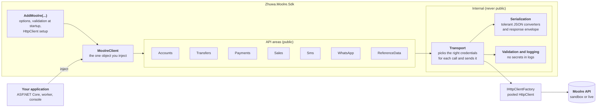
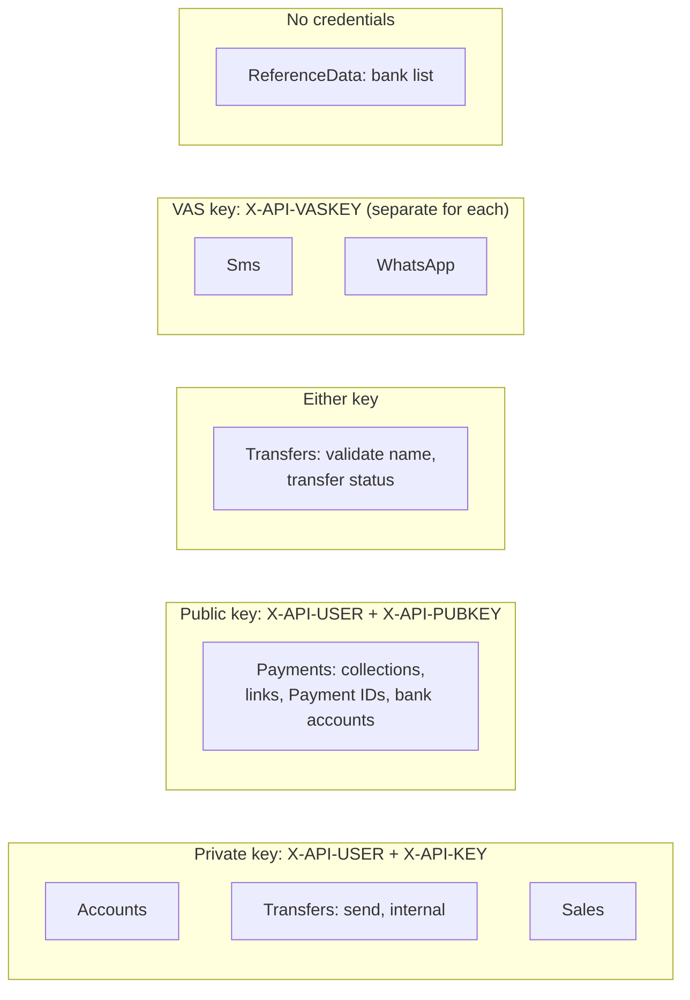
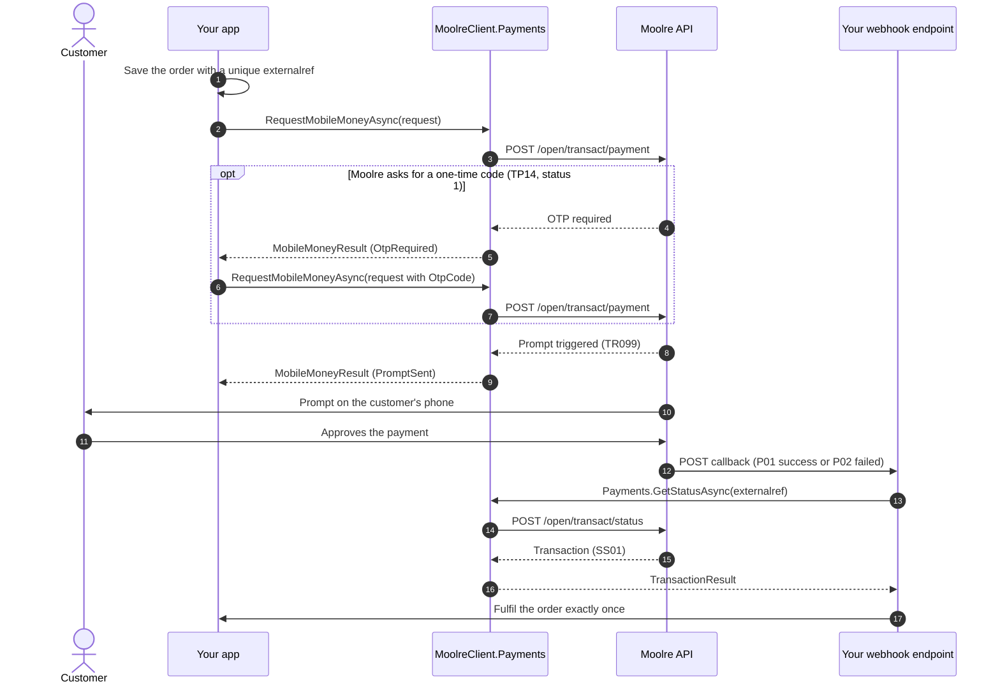
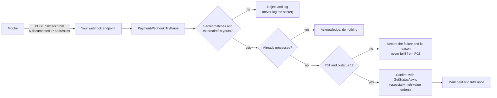
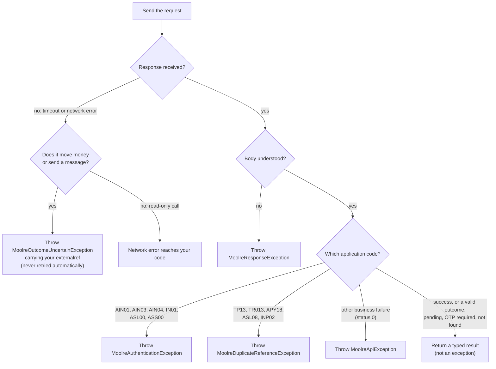
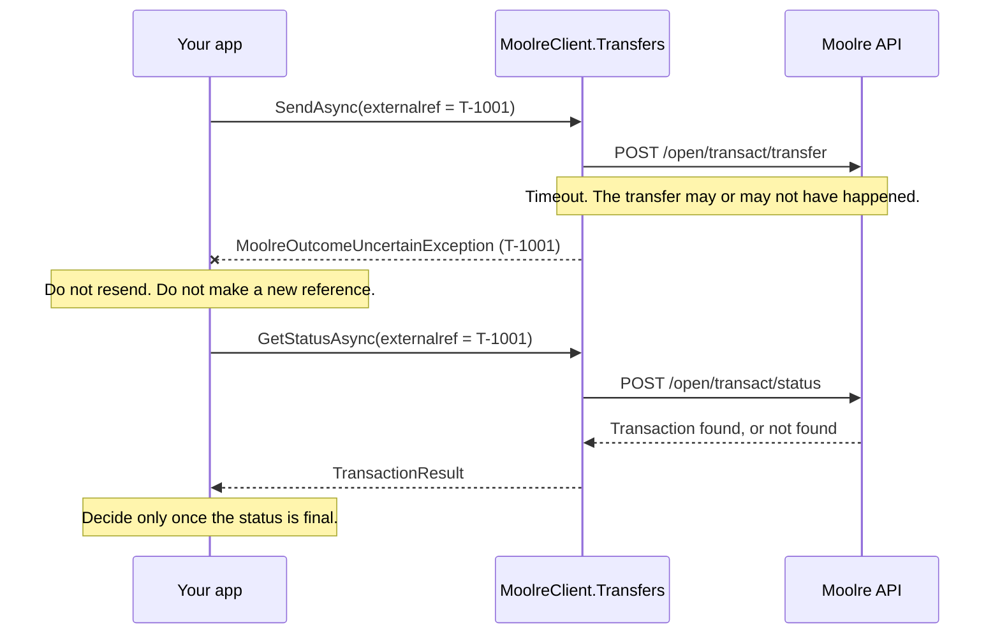

# Moolre .NET SDK

An **unofficial, community-built** .NET client for the [Moolre](https://docs.moolre.com/) API, maintained by [Zhuwa Africa](https://github.com/zhuwaafrica). NuGet package: `Zhuwa.Moolre.Sdk`.

> [!NOTE]
> This project is independent. It is not affiliated with, endorsed by, or supported by Moolre.

> [!WARNING]
> **Status: preview.** The request, result and model types and the endpoint table exist and are tested, but **only two Moolre calls work so far** (`Accounts.GetStatusAsync` and `ReferenceData.GetBanksAsync`); the other 29 are not implemented yet. The diagrams below show how the SDK is designed to work. The NuGet page text is in [`package-readme.md`](package-readme.md).

**On this page:** [How it fits together](#how-it-fits-together) · [Collecting a payment](#collecting-a-payment) · [Receiving a webhook](#receiving-a-webhook) · [When something goes wrong](#when-something-goes-wrong) · [Repository layout](#repository-layout) · [Build and test](#build-and-test)

## Planned usage

Dependency injection first: register once, then inject `MoolreClient` wherever you need it.

```csharp
builder.Services.AddMoolre(options =>
{
    options.Environment = MoolreEnvironment.Sandbox;   // sandbox is the default; live is an explicit choice
    options.ApiUser = "...";                           // from configuration or a secret store, never source code
    options.PublicKey = "...";
    options.PrivateKey = "...";
    options.AccountNumber = "...";
});

public class CheckoutService(MoolreClient moolre)
{
    // await moolre.Payments.RequestMobileMoneyAsync(...);
    // await moolre.Payments.GetStatusAsync(...);
}
```

## How it fits together

Your code only ever touches the public part of the SDK. Everything below the area clients is internal, so it can change without breaking you.



Which credentials each area uses (Moolre issues separate keys per wallet and per service):



## Collecting a payment

A mobile money collection is asynchronous: the SDK asks Moolre to prompt the customer, and the final result arrives later by webhook. Always confirm with a status lookup before fulfilling an order.



## Receiving a webhook

Moolre calls your endpoint when a payment succeeds or fails. The SDK gives you a parser and a secret check; deciding what to do stays in your code.



## When something goes wrong

Moolre can answer with an error, or not answer at all. The SDK treats the two very differently, because a timeout on a payment does not mean the payment failed.



What to do after an uncertain outcome:



## Money safety

- Payment, transfer, sales and messaging calls are **never retried automatically**.
- You supply the external reference. After a timeout the SDK throws an exception that carries it, so you can check the status instead of paying twice.
- A callback or a browser redirect is not proof of payment. Confirm the status before fulfilling an order.
- If you add a resilience handler to the `HttpClient`, do not retry `POST` requests blindly: every Moolre call is a `POST`, including read-only status lookups.

## Repository layout

| Path | Contents |
| --- | --- |
| `src/Zhuwa.Moolre.Sdk/` | The library (`net10.0`). One folder per API area (`Accounts`, `Transfers`, `Payments`, `Sales`, `Sms`, `WhatsApp`, `Reference`). Each area keeps everything for that feature together: the public client, its internal implementation (`DefaultMoolre<Area>`) and response mapper (`<Area>Mapper`) at the folder root, plus `Enums/` (C# enums only), `Models/` (data types and text-based value types), `Requests/` and `Results/` as needed. Shared core types use the same folder names at the project root, plus `Clients/` and `Configuration/`; the response codes are in `Models/ResponseCodes/`. Also `Errors/`, `Webhooks/`, `DependencyInjection/`, and `Internal/` (shared plumbing: transport, serialization, options validation; never public API) |
| `src/Zhuwa.Moolre.Sdk/.PublicAPI/` | The reviewed public API surface (`Shipped` and `Unshipped`); an unlisted public change fails the build |
| `tests/Zhuwa.Moolre.Sdk.Tests/` | xunit v3 tests mirroring the source layout; `Fixtures/` holds Moolre's documented example responses; no network, no credentials |
| `samples/` | Sample applications (added with the code they exercise) |
| `Directory.Build.props`, `Directory.Packages.props`, `BannedSymbols.txt`, `.editorconfig`, `global.json` | Shared build settings, central package versions, banned APIs, analyzer rules, pinned SDK |

## Build and test

```bash
dotnet restore
dotnet build -c Release
dotnet test -c Release
dotnet pack src/Zhuwa.Moolre.Sdk -c Release
```

The .NET SDK is pinned in `global.json`. Build output goes to `artifacts/`. Warnings are errors; see [CONTRIBUTING.md](CONTRIBUTING.md).

## More

- [Troubleshooting](TROUBLESHOOTING.md)
- [Changelog](CHANGELOG.md)
- [Contributing](CONTRIBUTING.md), [Security policy](SECURITY.md) and [Code of Conduct](CODE_OF_CONDUCT.md)

## License

[MIT](LICENSE)
