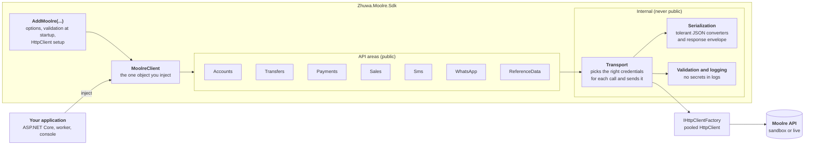
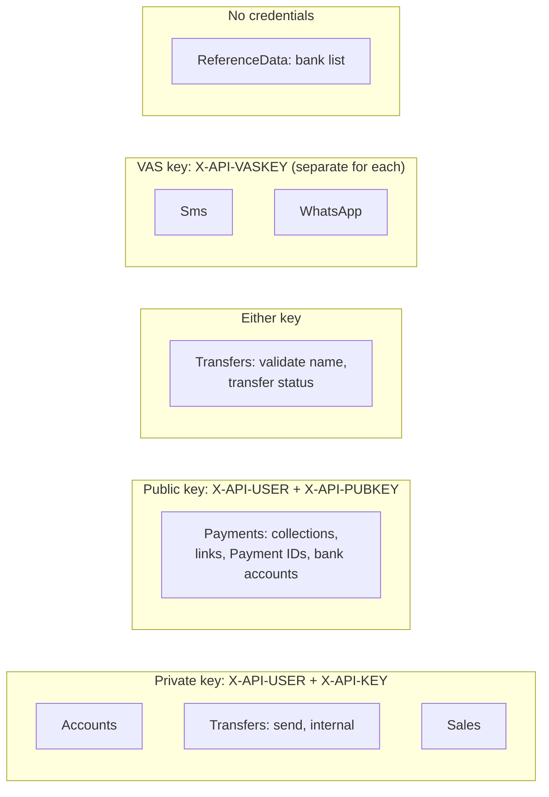
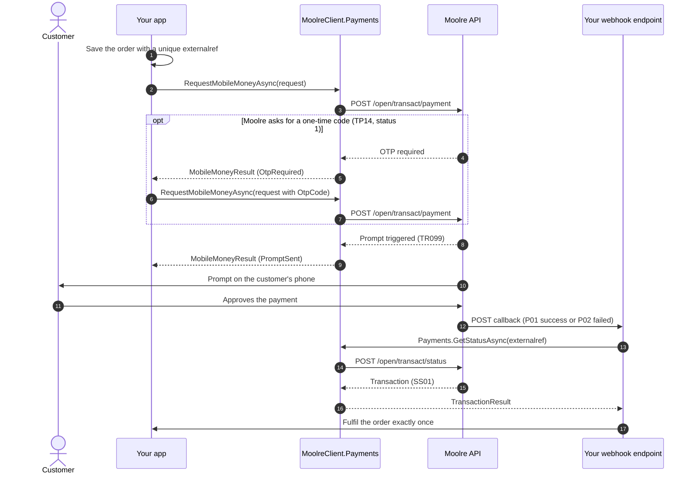
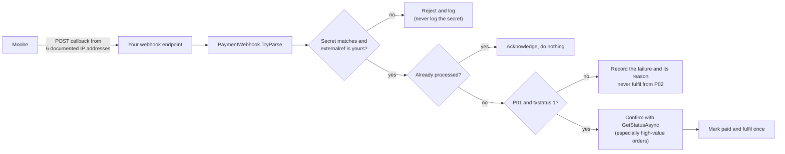
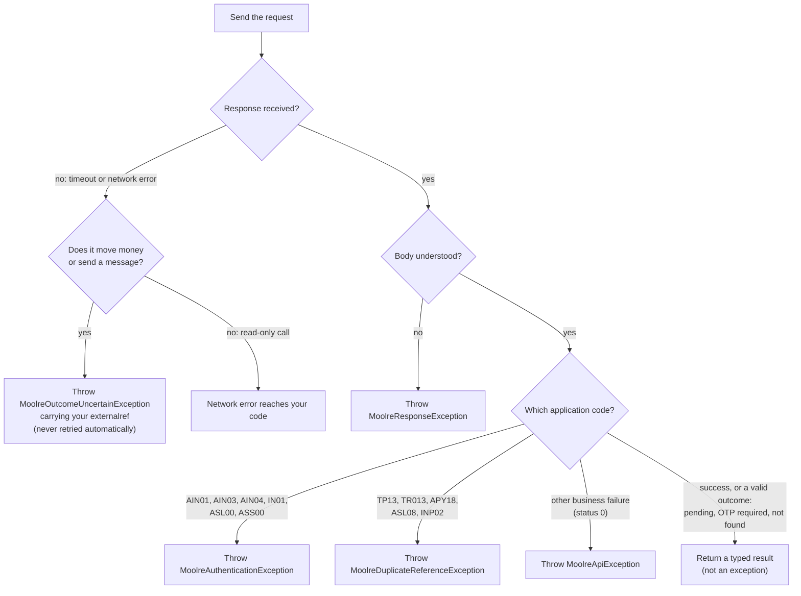
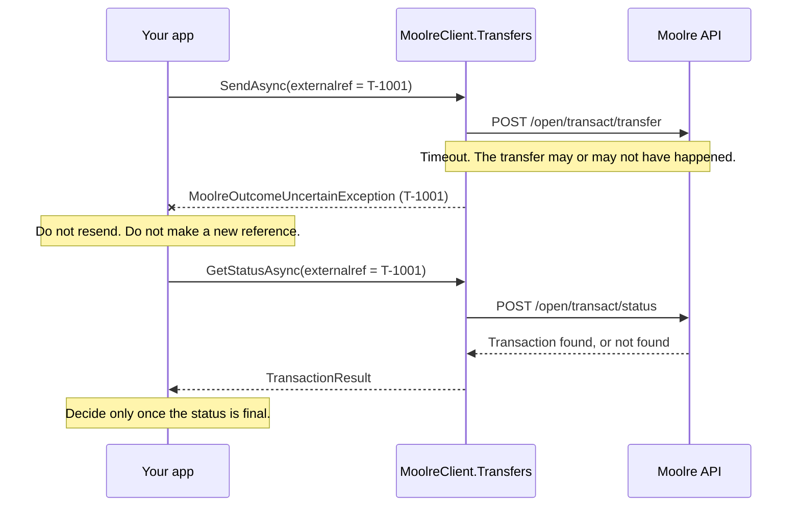

# Architecture

How the SDK works inside, for contributors and anyone curious. Using the SDK does not require any of this; start with [Getting started](getting-started.md).

## How it fits together

Your code only ever touches the public part of the SDK. Everything below the area clients is internal, so it can change without breaking you.

Which credentials each area uses (Moolre issues separate keys per wallet and per service):

## Collecting a payment

A mobile money collection is asynchronous: the SDK asks Moolre to prompt the customer, and the final result arrives later by webhook. Always confirm with a status lookup before fulfilling an order.

## Receiving a webhook

Moolre calls your endpoint when a payment succeeds or fails. The SDK gives you a parser and a secret check; deciding what to do stays in your code.

Moolre documents no signature, so `MoolreWebhookVerifier.IsSecretValid` (the callback secret, compared in constant time) is the verification. Moolre also publishes the addresses it sends callbacks from. Filter them in your firewall, load balancer or reverse proxy, not in application code; Moolre can change them, so check its documentation:

| IPv4 | IPv6 |
| --- | --- |
| `174.138.44.22` | `2604:a880:400:d1:0:3:4cf0:c001` |
| `174.138.40.67` | `2604:a880:400:d0::1a77:4001` |
| `192.241.135.134` | `2604:a880:400:d0::4234:2001` |

(As listed on Moolre's payment webhook page, read 14 November 2026.)

## When something goes wrong

Moolre can answer with an error, or not answer at all. The SDK treats the two very differently, because a timeout on a payment does not mean the payment failed.

What to do after an uncertain outcome:

## Repository layout

| Path | Contents |
| --- | --- |
| `src/Zhuwa.Moolre.Sdk/` | The library (`net10.0`), laid out exactly like the official Square .NET SDK. Root: `MoolreClient` and `MoolreClientFactory` only. One folder per API area (`Accounts`, `Transfers`, `Payments`, `Sales`, `Sms`, `WhatsApp`, `Reference`, `Webhooks`) with the area client, its internal implementation and mapper, and a `Requests/` folder. `Types/`: every result, model, enum and response code, grouped into one subfolder per area plus `_common/` for shared types (Stripe groups its `Entities/` the same way). `Core/`: internal plumbing (transport, serialization, validation); `Core/Public/`: options, environment and exceptions. `DependencyInjection/`: `AddMoolre` |
| `src/Zhuwa.Moolre.Sdk/.PublicAPI/` | The reviewed public API surface (`Shipped` and `Unshipped`); an unlisted public change fails the build |
| `tests/Zhuwa.Moolre.Sdk.Tests/` | xunit v3 unit tests mirroring the source layout; `Fixtures/` holds Moolre's documented example responses; no network, no credentials |
| `tests/Zhuwa.Moolre.Sdk.IntegrationTests/` | Tests against Moolre's real sandbox, skipped unless you opt in with environment variables (see its README) |
| `samples/` | Sample applications (added with the code they exercise) |
| `Directory.Build.props`, `Directory.Packages.props`, `BannedSymbols.txt`, `.editorconfig`, `global.json` | Shared build settings, central package versions, banned APIs, analyzer rules, pinned SDK |
